### 📺 Demonstration
A complete prototype and software demonstration is available through the project's YouTube video.


YouTube: https://youtu.be/NYvcRXcdNOI

### 🏆 Smart India Hackathon 2026
Project: BeltSentinel AI
Problem Statement: 26008
Domain: Conveyor Belt Monitoring and Damage Detection
Focus: AI-Based Condition Monitoring & Early Warning
### 👥 Team iNNOVATORS_0078
BELTSENTINEL-AI
Developed as a Smart India Hackathon 2026 prototype.

## 📜 Disclaimer
BeltSentinel AI is a prototype developed for demonstration, experimentation, and validation of the proposed monitoring architecture. Performance in real industrial mining environments may vary depending on camera conditions, sensor configuration, conveyor characteristics, environmental conditions, and operational data. Industrial deployment would require appropriate hardware qualification, integration, testing, safety validation, and field trials.

# BELTSENTINEL AI
### Intelligent Conveyor Belt Health Monitoring & Early Damage Detection

<p align="center">
  <strong>AI-Powered • Sensor-Driven • Joint-Level • Real-Time Conveyor Monitoring</strong>
</p>

---

## 🚀 Overview

**BeltSentinel AI** is an intelligent conveyor belt health monitoring and early damage detection prototype developed for **Smart India Hackathon (SIH) 2026 – Problem Statement 26008**.

The system combines **AI-based computer vision, ESP32 sensor telemetry, encoder-based belt position tracking, joint-level localization, risk assessment, analytics, alerts, and maintenance reporting** into a unified monitoring platform.

The objective is to demonstrate how continuous digital monitoring can help identify conveyor belt abnormalities at an early stage and provide operators with actionable condition information.

---

## 🎯 Problem

Conveyor belts in mining and material-handling environments operate continuously under demanding conditions. Cracks, tears, edge damage, and joint deterioration can develop over time and may lead to:

- Unplanned downtime
- Increased maintenance requirements
- Material loss and spillage
- Reduced conveyor availability
- Equipment damage
- Difficult and time-consuming manual inspection

Traditional inspection approaches may depend heavily on periodic manual checks. BeltSentinel AI demonstrates a technology-driven approach for **continuous condition monitoring and early identification of visible belt abnormalities**.

---

## 💡 Our Solution

BeltSentinel AI integrates multiple monitoring layers into a single system:

```text
                 ┌─────────────────────┐
                 │   Conveyor Belt     │
                 └──────────┬──────────┘
                            │
             ┌──────────────┴──────────────┐
             │                             │
       Camera + AI                    ESP32 + Sensors
             │                             │
       YOLO Detection              Telemetry Collection
             │                             │
             └──────────────┬──────────────┘
                            │
                    Backend Processing
                            │
             ┌──────────────┴──────────────┐
             │                             │
       Joint Localization            Risk Assessment
             │                             │
             └──────────────┬──────────────┘
                            │
                     SQLite Database
                            │
                            ▼
                 Web Monitoring Dashboard
                            │
          ┌─────────────────┼─────────────────┐
          │                 │                 │
       Live Data          Alerts          Analytics
          │                                   │
          └────────────── Reports ────────────┘
```


## 🔍 AI-Based Damage Detection
The computer-vision module uses Ultralytics YOLO to identify visible conveyor belt abnormalities from camera input.
### Supported damage classes
| Class | Description |
|---|---|
| Belt Crack | Visible cracks or surface damage |
| Belt Tear | Visible tearing or rupture-related damage |
| Edge Damage | Damage affecting the belt edge |
| Joint Damage | Visible abnormalities around belt joints |
Detection results can be associated with belt/joint locations and displayed through the monitoring dashboard.


## 📡 ESP32 Sensor Telemetry
The prototype uses an ESP32-based telemetry layer for collecting conveyor-related sensor information.
### Current prototype sensors
- Rotary Encoder
- SW-420 Vibration Sensor
- LM393 Acoustic Sensor
- DHT11 Temperature & Humidity Sensor
- Motor monitoring interface
### Telemetry includes parameters such as:
- Encoder position/pulses
- Vibration events
- Acoustic activity
- Temperature
- Humidity
- Motor status
- Motor PWM
The current prototype transfers telemetry through USB serial communication between the ESP32 and the monitoring computer.


## 🎯 Joint-Level Monitoring
A key feature of BeltSentinel AI is location-aware conveyor joint monitoring.
The physical prototype contains:
- 120 cm mini conveyor belt
- 5 physical joints
- Joint identifiers: J1, J2, J3, J4, J5
Encoder-based position tracking is used to synchronize the physical conveyor movement with the software's joint-monitoring logic.
This enables the system to associate detected abnormalities with specific belt/joint regions.
For demonstration purposes, damage has been intentionally placed on or near the prototype joints so that the joint-level monitoring functionality can be visibly demonstrated.


## 🧠 AI + Sensor-Based Risk Assessment
BeltSentinel AI combines available visual detection and telemetry information within its monitoring and risk-analysis pipeline.
The dashboard presents conveyor conditions using three operational levels:
🟢 Normal
No significant abnormal condition detected.
🟡 Warning
An abnormal condition requiring attention has been identified.
🔴 Critical
A significant condition requiring immediate inspection or maintenance attention has been identified.
This risk-oriented presentation helps convert raw detection and telemetry data into information that is easier for operators and maintenance personnel to interpret.


## 📊 Intelligent Monitoring Dashboard
The BeltSentinel AI web dashboard provides a centralized interface for monitoring the conveyor system.
### Dashboard capabilities
- Live sensor telemetry
- Live camera feed
- AI-based damage detection
- Joint-level monitoring
- Conveyor operating status
- Risk status
- Real-time alerts
- Historical records
- Sensor analytics
- Detection analytics
- Conveyor health trends
- Maintenance intelligence
- Joint calibration
- System configuration
- CSV report generation
- JSON report generation
- Mobile-accessible monitoring interface


## 🚨 Alerts & Notifications
The system provides real-time alerts for important conveyor conditions.
### Alerts can include:
- Warning conditions
- Critical conditions
- Abnormal sensor conditions
- AI-detected belt abnormalities
- Joint/location information
This provides operators with a quick way to identify conditions requiring attention.


## 📈 Analytics & Maintenance Intelligence
Historical system information is used to provide:
- Sensor trends
- AI detection history
- Risk trends
- Conveyor-state information
- Historical monitoring records
- Maintenance-oriented insights
The system also supports structured report generation for monitoring and maintenance workflows.


## 📄 Reports & Data Export
BeltSentinel AI supports exporting monitoring information in:
- CSV
- JSON
Reports can contain information such as:
- AI detections
- Telemetry records
- Joint status
- System configuration
- Abnormality information
- Maintenance-related records
This allows monitoring information to be retained for further analysis and documentation.


## 🏗️ Prototype Hardware
The current demonstration prototype consists of:
| Component | Purpose |
|---|---|
| 120 cm Mini Conveyor | Physical conveyor demonstration |
| ESP32 | Sensor acquisition and telemetry |
| Camera | Visual belt inspection |
| Rotary Encoder | Belt position tracking |
| SW-420 | Vibration/event monitoring |
| LM393 | Acoustic event monitoring |
| DHT11 | Temperature & humidity monitoring |
| L298N Motor Driver | DC motor control |
| DC Motor | Conveyor movement |


## 🛠️ Technology Stack
### Artificial Intelligence
- Ultralytics YOLO
- Computer Vision
- OpenCV
### Backend
- Python
- Flask
- REST/API-based communication
- SQLite
### Embedded System
- ESP32
- Arduino/C++
- Sensor telemetry
- Encoder-based tracking
### Frontend
- HTML
- CSS
- JavaScript
- Web Dashboard
### Dataset & Model Preparation
- Roboflow
- YOLO-compatible dataset preparation
- Model training and validation


## 🔄 System Workflow

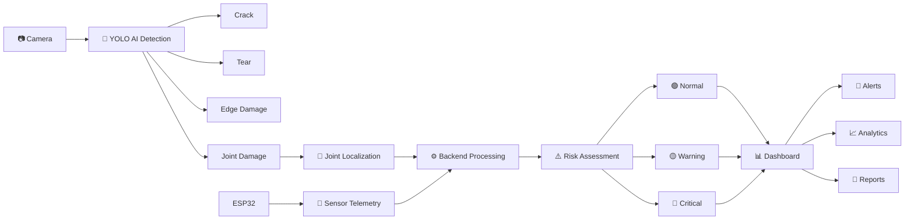


## 🧪 Prototype Demonstration
The prototype demonstrates the complete monitoring workflow using a 120 cm mini conveyor with five physical joints (J1–J5).
### The demonstration covers:
1. Conveyor operation
2. ESP32 sensor telemetry
3. Camera-based inspection
4. AI damage detection
5. Encoder-based joint tracking
6. Risk assessment
7. Live dashboard monitoring
8. Alerts and notifications
9. Historical analytics
10. Maintenance reporting
11. CSV/JSON data export


## 📁 Repository Structure

```text
BELTSENTINEL-AI/
│
├── backend/              # Flask backend and processing
├── camera/               # Camera and vision modules
├── dashboard/            # Web dashboard
├── database/             # SQLite database
├── images/               # Dashboard interface
├── esp32/                # ESP32 firmware and telemetry
├── models/               # Trained YOLO models
├── simulator/            # Sensor simulation utilities
├── yolo/                 # Dataset and model training utilities
│
├── .env.example
├── .gitignore
├── README.md
└── requirements.txt
```

## ⚙️ Running the Project
1. Clone the repository
```powershell
git clone https://github.com/prathmeshghule430/BELTSENTINEL-AI.git
cd BELTSENTINEL-AI
```
2. Create a virtual environment
```powershell
python -m venv venv
```
3. Activate the environment
Windows
```powershell
venv\Scripts\activate
```
4. Install dependencies
```powershell
pip install -r requirements.txt
```
5. Start the backend
```powershell
python -m backend.app
```
6. Open the dashboard
```text
http://127.0.0.1:5000/
```
Hardware-dependent features require the ESP32, connected sensors, camera, and the appropriate serial configuration.


## 📌 Current Prototype Scope
BeltSentinel AI is currently a working prototype and conceptual demonstration.
The prototype validates the core architecture of:
AI Vision + Sensor Telemetry + Joint Tracking + Risk Assessment + Dashboard + Alerts + Analytics + Reporting
The current implementation is intended to demonstrate the feasibility of the proposed approach rather than represent a final industrial deployment.


## 🔮 Future Industrial Extensions
The architecture can be further extended for real-world mining environments through:
- Industrial-grade cameras
- Thermal imaging
- Additional load and tension sensing
- Industrial communication infrastructure
- PLC/SCADA integration
- Plant-level monitoring integration
- Larger operational datasets
- Advanced predictive-failure modelling
- Industrial hardware ruggedization
- Extended field validation
- Drone-assisted inspection where appropriate
- Digital-twin capabilities
These extensions are considered future development areas for industrial-scale deployment.


## 🎯 Project Objective
The objective of BeltSentinel AI is to demonstrate a unified digital approach for continuous conveyor belt condition monitoring and early identification of belt abnormalities, helping provide operators and maintenance personnel with timely, location-aware information through AI, sensor telemetry, analytics, and intelligent visualization.

## 📊 Demo Dashboard Interface

The BELTSENTINEL AI dashboard provides a centralized interface for monitoring conveyor belt conditions, viewing AI-based damage detections, analyzing sensor telemetry, managing alerts, and generating maintenance reports. It integrates computer vision and IoT monitoring to support early identification of conveyor belt abnormalities.

### 1. Main Dashboard

The main dashboard provides an overview of the conveyor monitoring system, including system status, available sensor information, belt condition indicators, and important monitoring information.

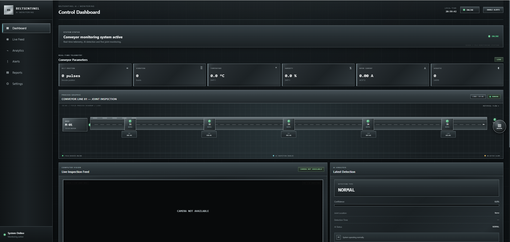
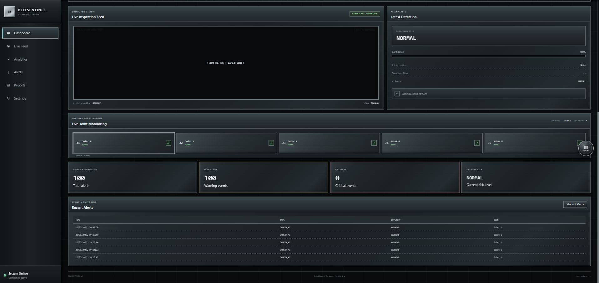

### 2. Live Camera Feed and AI Inspection

The Live Feed interface is intended for visual inspection of the conveyor belt. The camera feed can be used with the YOLO-based vision model to identify visible belt abnormalities, including cracks, tears, edge damage, and joint damage, when detected by the system.


### 3. Analytics Dashboard

The analytics interface helps users review monitoring information and understand system trends to support condition assessment and maintenance planning.

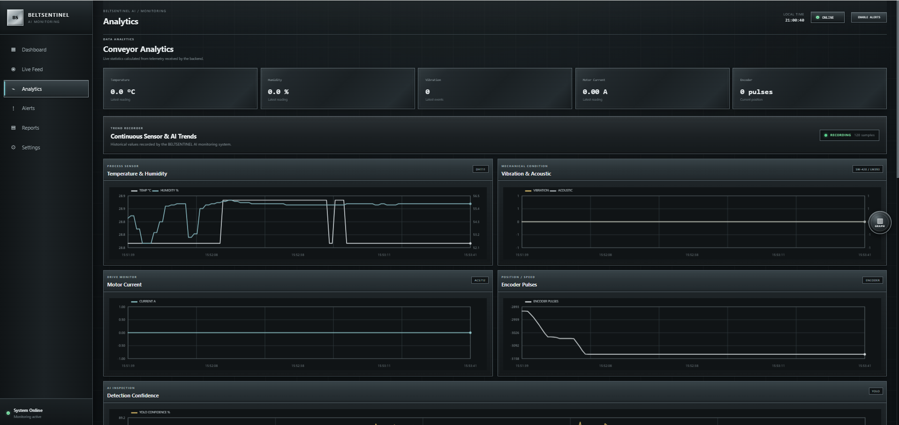
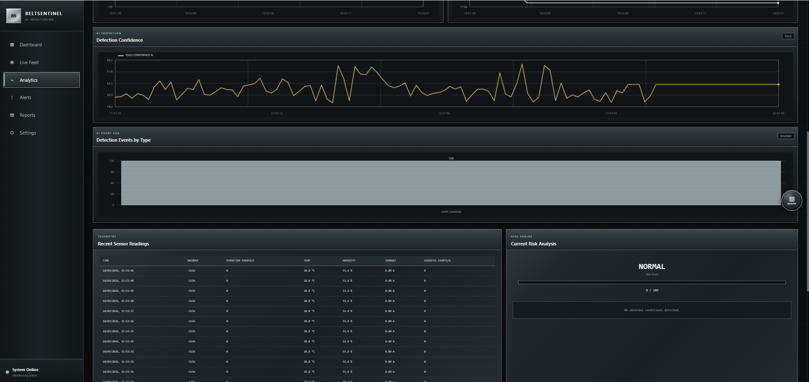
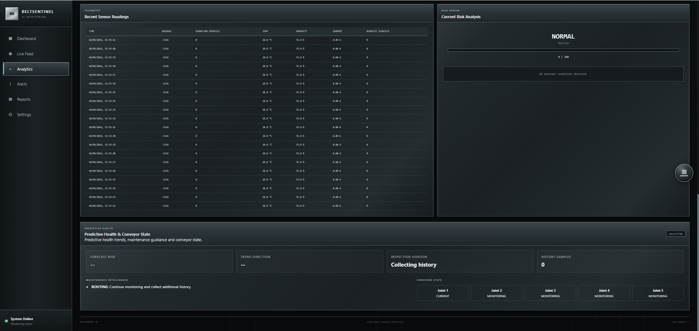
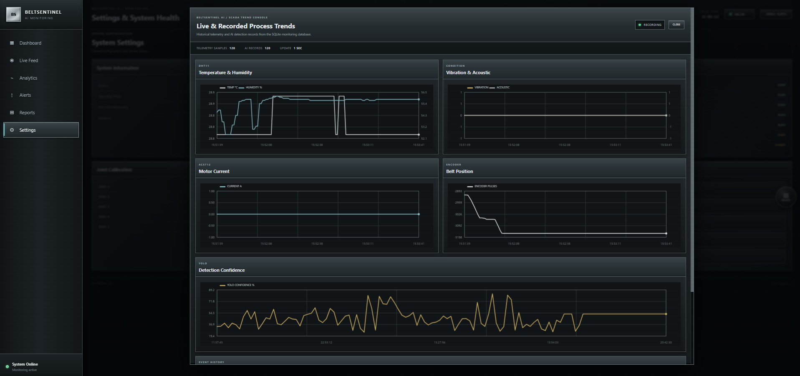

### 4. Alerts

The Alerts interface provides a place to review detected issues and system warnings. BELTSENTINEL AI is designed to classify conveyor conditions as **Normal, Warning, or Critical** based on the implemented monitoring and risk-assessment logic.

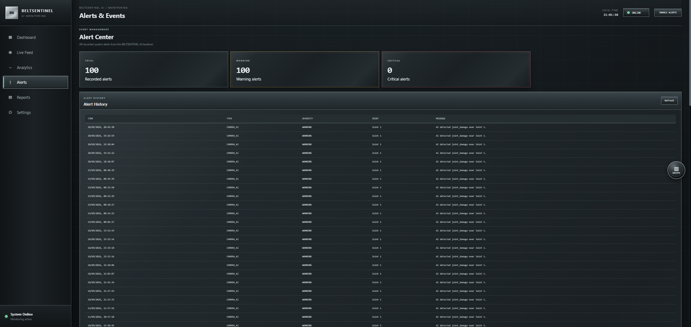
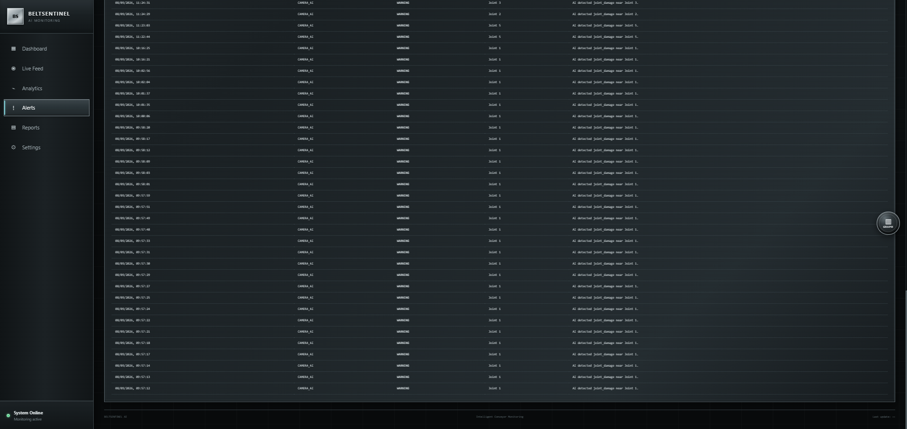

### 5. Maintenance Reports and Data Export

The Reports interface supports reviewing monitoring records and maintenance-related information. The project supports CSV and JSON report generation for further analysis and documentation.

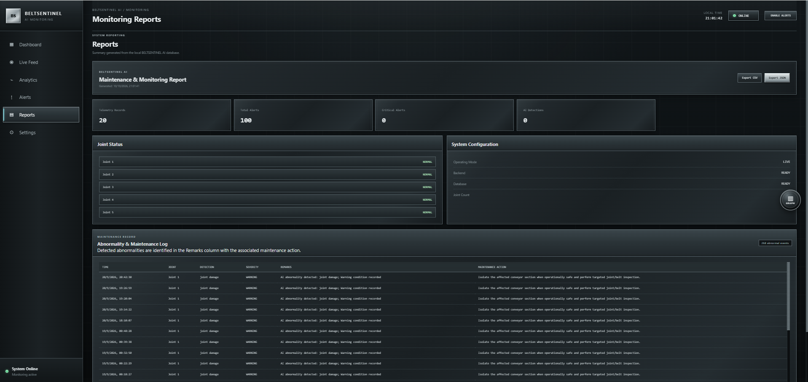

### 6. System Settings

The Settings interface provides access to the dashboard's available configuration options for managing the monitoring system.

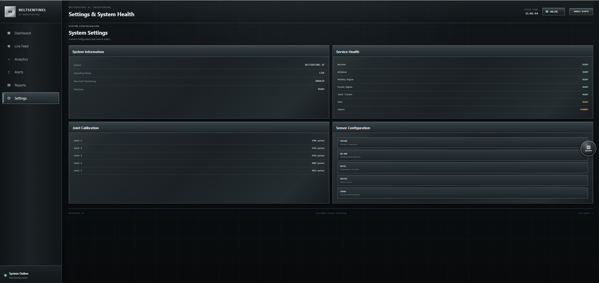

---

### How the Dashboard Supports Conveyor Monitoring

- **AI Vision:** Detects visible belt damage using the trained YOLO model.
- **IoT Sensor Monitoring:** Displays available telemetry from the ESP32 sensor system.
- **Belt Position Tracking:** Uses encoder information to support belt movement and joint-level monitoring.
- **Risk Assessment:** Supports Normal, Warning, and Critical condition classification.
- **Analytics and Alerts:** Helps users review monitoring information and identify potential maintenance needs.
- **Reporting:** Supports exporting monitoring information in CSV and JSON formats.

The dashboard is part of the BELTSENTINEL AI prototype, developed to demonstrate intelligent conveyor belt monitoring and early warning capabilities for iron ore mining applications.


### ⚠️ Note – Demo Live Dashboard

**Demo Live Dashboard:**  https://beltsentinel-ai.onrender.com

You can also view the dashboard interface screenshots directly in this README under **Demo Dashboard Interface**.
---

<p align="center">
  <a href="#demo-dashboard-interface">📸 Go to Dashboard Interface</a>
</p>

*Note: The live dashboard may take approximately one minute to load after inactivity because of Render's free hosting environment. Please wait briefly if it does not open immediately.*

Thank you for reviewing BELTSENTINEL AI!
---

<p align="center">
  <a href="#beltsentinel-ai">⬆️ Back to Top</a>
</p>